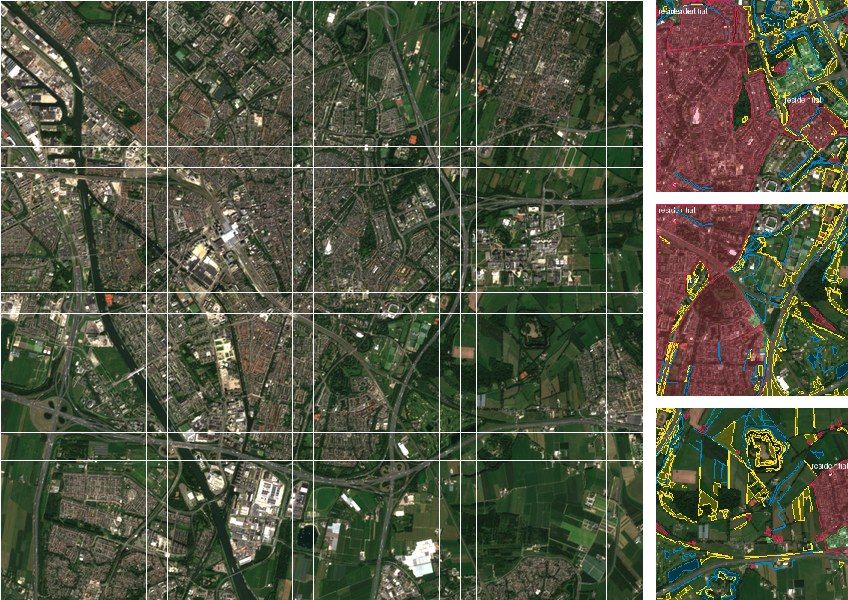

# geochips

[](https://github.com/ngo-binh0108/geochips/actions/workflows/tests.yml)
[](LICENSE)

**Turn a GeoTIFF and a GeoJSON of polygons into a YOLO or COCO training set in one command.**

```bash
geochips scene.tif -l buildings.geojson -o dataset -f yolo-seg -s 512 --val 0.2
yolo segment train data=dataset/data.yaml
```



Satellite and aerial images are too big to train on directly, and their labels use a
different coordinate system from the pixels. geochips handles that step:

- **Reprojects labels** from any CRS (GeoJSON is lon/lat by default) to the raster's pixel grid.
- **Tiles the image** into fixed-size chips with optional overlap. Edge chips are shifted to end on
  the image border, so every chip has the same size and nothing is padded.
- **Clips polygons** to each chip, splits multipolygons, and drops slivers and mostly-cut objects.
- **Writes** YOLO boxes, YOLO segmentation, or COCO JSON, plus `data.yaml` for Ultralytics.
- **Converts** 16-bit or float imagery to 8-bit with one percentile stretch per scene, so
  brightness is consistent across chips. Or keep the original values as GeoTIFF chips.
- **Skips** chips that are mostly nodata, or that have no labels.
- **Splits** train/val per chip, or per scene to avoid leakage between overlapping chips.

It has four dependencies: `rasterio`, `shapely`, `numpy` and `pillow`.

## Install

```bash
pip install git+https://github.com/ngo-binh0108/geochips
```

To read Shapefile or GeoPackage labels, add geopandas: `pip install geopandas`.

## Try it on real data

```bash
python examples/download_demo.py examples/data     # a Sentinel-2 crop of Utrecht + OSM land use
geochips examples/data/utrecht_s2.tif -l examples/data/utrecht_landuse.geojson \
    -o out/utrecht -f yolo-seg -s 256 --overlap 32 --val 0.2 --preview 10
```

```
classes: farmland, forest, grass, industrial, residential, water
train: 16 chips, 8994 labels
val: 4 chips, 2938 labels
written to out/utrecht
```

Open `out/utrecht/preview/` to check that the labels sit where they should.

## Output

`-f yolo` and `-f yolo-seg` (Ultralytics layout):

```
dataset/
├── data.yaml
├── images/train/scene_0_0.png  ...
└── labels/train/scene_0_0.txt  ...   # cls cx cy w h   or   cls x1 y1 x2 y2 ...
```

`-f coco`:

```
dataset/
├── annotations/instances_train.json   # bbox + polygon segmentation + area
└── images/train/scene_0_0.png  ...
```

Chips are named `<raster>_<row>_<col>`, the pixel offset of the chip in the source image.
COCO image entries also record the source raster and window.

## Options

| Option | Default | Meaning |
|---|---|---|
| `-f, --format` | `yolo` | `yolo`, `yolo-seg` or `coco` |
| `-s, --size` | `512` | chip size in pixels |
| `--overlap` | `0` | overlap between neighbouring chips in pixels |
| `--class-field` | `class` | label property with the class name (missing → `object`) |
| `--classes` | all, sorted | class names in id order; other classes are dropped |
| `--bands` | all | 1-based bands, e.g. `4,3,2` for Sentinel-2 true colour |
| `--image-format` | `png` | `png`, `jpg`, or `tif` (original dtype, georeferenced) |
| `--min-visible` | `0` | drop objects with less than this fraction of their area in the chip |
| `--min-area` | `4` | drop clipped fragments smaller than this many pixels |
| `--max-nodata` | `1` | skip chips with a larger nodata fraction |
| `--skip-empty` | off | skip chips without labels |
| `--val` | `0` | fraction of chips (or scenes) for validation |
| `--split-by` | `chip` | `chip`, or `image` to keep each scene in one split |
| `--seed` | `0` | random seed for the split |
| `--preview N` | `0` | also save N chips with labels drawn on them |

You can pass several rasters, or a directory of them, at once. Labels outside a raster are ignored.

## Python API

```python
from geochips import ChipConfig, make_chips

stats = make_chips(
    ["tiles/a.tif", "tiles/b.tif"], "labels.geojson", "dataset",
    fmt="coco",
    config=ChipConfig(size=640, overlap=64, skip_empty=True, val_fraction=0.2, split_by="image"),
)
```

To feed a training loop directly instead of writing files, `iter_chips()` yields `Chip` objects
holding the image array, clipped labels, window and transform:

```python
from geochips import ChipConfig, iter_chips, load_labels

labels, crs = load_labels("labels.geojson")
for chip in iter_chips(["scene.tif"], labels, crs, ChipConfig(size=512)):
    print(chip.name, chip.image.shape, len(chip.labels))
```

## Notes

- COCO and YOLO polygons store only the outer ring of each polygon; holes count only towards `area`.
- With `--overlap` and `--split-by chip`, the same ground can appear in both train and val. Use
  `--split-by image` when you have several scenes.
- Points and lines are ignored; buffer them into polygons first.

## Contributing

Bug reports and pull requests are welcome. To run the tests:

```bash
pip install -e ".[test]"
pytest
```

## License

MIT. The demo image contains modified Copernicus Sentinel data (2025). Labels © OpenStreetMap
contributors, ODbL.
